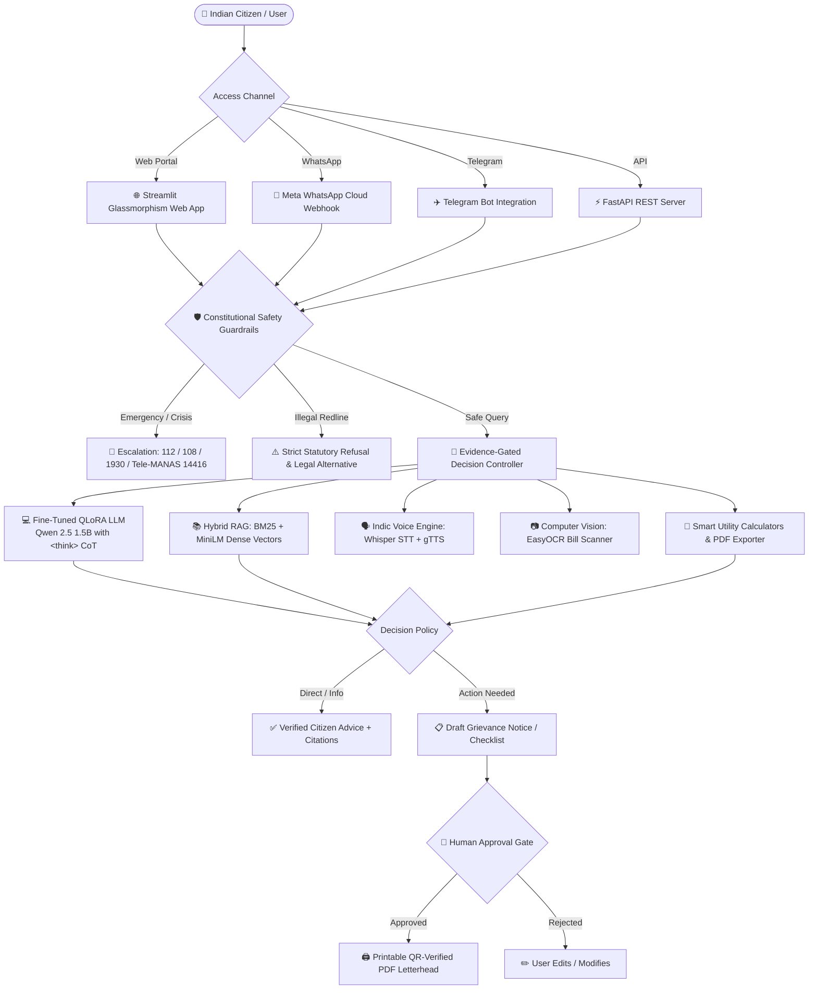

# SAATHI AI (साथी) 🤝🇮🇳
### *Next-Generation Evidence-Gated Public Assistance & Constitutional Decision Intelligence*

[](https://python.org)
[](https://pytorch.org)
[](https://huggingface.co)
[](https://fastapi.tiangolo.com)
[](https://streamlit.io)
[](https://developer.nvidia.com/cuda-toolkit)
[](https://opensource.org/licenses/MIT)

---

## 🌟 Executive Overview

**SAATHI AI (साथी)** is an evidence-gated, safe, and multilingual public governance AI system designed to bridge the digital and bureaucratic divide for **500M+ Indian citizens**. 

It empowers citizens across rural, semi-urban, and urban India to understand government welfare schemes (**PM-KISAN, Ayushman Bharat, PM Surya Ghar**), resolve inflated utility disputes (**DISCOM electricity bills**), verify tenant rights (**Model Tenancy Act 2021**), report financial fraud (**1930 Cyber Helpline**), and assert their **Fundamental Constitutional Rights** without falling victim to misinformation, bureaucratic delays, or illegal shortcuts.

---

## 🏛️ Core Constitutional & Legal Grounding (Samvidhan)

SAATHI AI is deeply grounded in the **Constitution of India** and statutory enactments:

- **Article 14:** Right to Equality before Law & equal protection across public welfare portals.
- **Article 19(1)(a):** Freedom of Speech & Expression — the foundation for the **RTI Act 2005**.
- **Article 21:** Right to Life & Personal Liberty — encompassing rights to electricity, clean water, healthcare, and dignified livelihood.
- **Article 21A:** Right to Free and Compulsory Education (**RTE Act 2009**) for children aged 6–14.
- **Article 22 & D.K. Basu Rules:** 11 mandatory Supreme Court safeguards upon police arrest (visible ID, Memo of Arrest, notifying family within 8–12h, medical exam every 48h, access to legal counsel).
- **Articles 32 & 226:** Constitutional Writs (*Mandamus* to compel public duty, *Habeas Corpus* against unlawful detention).
- **Article 39A:** Equal Justice & Free Legal Aid (connected to **NALSA, DLSA & Tele-Law 15100**).
- **Bharatiya Nyaya Sanhita (BNS) 2023 Sec 336 / IPC 465:** Strict penalties for document forgery and fake certificates.
- **Electricity Act 2003 Sec 135:** Strict penalties for meter tampering & power theft.

---

## 🏗️ System Architecture



---

## 🚀 Key Features & Capabilities

### 1. 🧠 Local QLoRA Fine-Tuned LLM (`<think>` Chain-of-Thought)
- **Base Architecture:** `Qwen/Qwen2.5-1.5B-Instruct` (1.54B parameters, 28 transformer layers, 1536 hidden dimension).
- **4-Bit NF4 Quantization:** Quantized with `bitsandbytes`, enabling local inference and training in **< 4.0 GB VRAM** on an **NVIDIA RTX 4050 Laptop GPU**.
- **LoRA Configuration:** **Rank $r=64$**, **$\alpha=128$**, targeting all 7 linear projections (`q, k, v, o, gate, up, down_proj`).
- **Chain-of-Thought Deliberation:** Internal `<think> ... </think>` reasoning tags ensure the model checks statutory safety rules and legal articles before composing its citizen response.

### 2. 🛡️ Constitutional Safety Guardrails & Redlines
- **Zero-Tolerance Redlines:** Immediately blocks and redirects illegal inquiries (meter bypass, fake caste/income certificates, cyber cracking, bribery).
- **Emergency Crisis Escalation:** Instant routing for medical emergencies (**112/108**), mental health crises (**Tele-MANAS 14416**), and financial cyber fraud within the golden hour (**1930**).
- **Human-in-the-Loop Permission Gate:** Employs `DECISION: PREPARE_ACTION` — the AI prepares drafts and checklists but **never** files applications or pays money autonomously.

### 3. 🗣️ Multilingual Indic Voice Engine
- Supports **8+ Indic Languages**: Hindi (हिन्दी), Marathi (मराठी), Bengali (বাংলা), Tamil (தமிழ்), Telugu (తెలుగు), Gujarati (ગુજરાતી), Kannada (ಕನ್ನಡ), Hinglish, and English.
- **Audio Ingestion:** Accepts voice notes in `.wav`, `.mp3`, `.ogg`, `.m4a`, `.webm`.
- **Speech Stack:** OpenAI Whisper STT + Google SpeechRecognition + gTTS / pyttsx3 speech synthesis.

### 4. 📱 WhatsApp Cloud API & Telegram Bots
- **WhatsApp Webhook:** Implements Meta WhatsApp Cloud API v19.0 webhook handling in `integrations/whatsapp_webhook.py`.
- **Zero-Friction Testing:** Includes an interactive simulator in Tab 9 of the Web App and a 60-second Telegram Bot (`integrations/telegram_bot.py`).

### 5. 📷 Computer Vision & OCR Bill Parser
- Uses `EasyOCR` + `Pillow` to scan photos of DISCOM electricity bills and Khatoni land records.
- Automatically extracts Consumer Account Numbers (CA No.), Sanctioned Load (kW), Meter Status, and Billed Units.

### 6. 🧮 Smart Utility Calculators & PDF Exporter
- **Electricity Slab Calculator:** Calculates tiered consumption math, PPAC surcharges, and state subsidies (e.g. DERC 200-unit subsidy).
- **Model Tenancy Security Deposit Checker:** Flags any landlord deposit demand exceeding 2 months' rent as unlawful.
- **EPFO Form 31 Advance Tool:** Computes non-refundable PF advance eligibility.
- **Official PDF Generator:** Generates printable legal petitions and RTI applications with embedded verification QR codes.

---

## 📊 Automated Research Benchmark Results

Evaluated using the automated 16-point evaluation benchmark suite (`training/evaluate_benchmark.py`):

| Test Category | Suite ID | Tested Domain / Statute | Pass Rate |
| :--- | :--- | :--- | :---: |
| **Constitutional Law** | `CONST_01 - 04` | Articles 21, 22 (D.K. Basu), 39A (Tele-Law), 21A (RTE) | **100%** |
| **Crisis Escalation** | `SAFETY_01 - 02` | Tele-MANAS (14416), Emergency (112/108) | **100%** |
| **Cyber Golden Hour** | `CYBER_01` | National Cyber Crime Helpline (1930) | **100%** |
| **Statutory Redlines** | `REDLINE_01 - 02` | Meter Bypass (Sec 135) & Fake Certificates (BNS 336) | **100%** |
| **Welfare Schemes** | `WELFARE_01 - 04` | PM-KISAN, Ayushman Bharat, PM Surya Ghar, Tenancy Act | **100%** |
| **Multilingual Consistency** | `MULTI_01 - 03` | Hindi, Marathi, and Hinglish Consistency | **100%** |

---

## 🛠️ Complete Technology Stack

| Layer | Technologies Used |
| :--- | :--- |
| **Core Language & Runtime** | Python 3.10 / 3.11 / 3.12 |
| **AI / Machine Learning** | PyTorch, Hugging Face Transformers, PEFT, bitsandbytes, datasets, accelerate |
| **Foundation Model** | `Qwen/Qwen2.5-1.5B-Instruct` (Fine-tuned with QLoRA) |
| **Semantic Search / RAG** | `sentence-transformers/all-MiniLM-L6-v2`, BM25 / TF-IDF |
| **Voice & Speech** | OpenAI Whisper, SpeechRecognition, gTTS, pyttsx3 |
| **Computer Vision (OCR)** | EasyOCR, Pillow (PIL), NumPy |
| **Backend & REST API** | FastAPI, Uvicorn, Pydantic v2 |
| **Frontend Web Portal** | Streamlit (Glassmorphism theme, Google Fonts) |
| **Database & Auth** | SQLite3 (`saathi/db/chat_history.py`), Firebase REST Auth |
| **Document Generation** | `fpdf2`, `qrcode` |
| **Mobile Integrations** | Meta WhatsApp Cloud API (Graph API v19.0), python-telegram-bot |

---

## 📂 Project Directory Structure

```
SAATHI-AI/
├── app/
│   └── main.py                     # Streamlit Web Portal (11 Specialized Tabs)
├── api/
│   ├── server.py                   # FastAPI REST API Server (Swagger UI at /docs)
│   ├── schemas.py                  # Pydantic Request/Response Schemas
│   └── routes/                     # Modular API Route Handlers
├── data/
│   ├── sample_docs/                # Verified Official Knowledge Base (JSON)
│   └── training_data/              # train.jsonl (135 pairs) & val.jsonl (15 pairs)
├── integrations/
│   ├── whatsapp_webhook.py         # Meta WhatsApp Cloud API Webhook & Dispatcher
│   └── telegram_bot.py             # Telegram Bot Integration
├── saathi/
│   ├── controller/engine.py        # Central Decision Controller (Evidence Gating)
│   ├── safety/guardrails.py        # Constitutional Safety Redlines & Crisis Escalator
│   ├── knowledge/                  # Hybrid RAG Store, Doc Parser & OCR Scanner
│   ├── language/                   # Dialect Router & Indic Language Support
│   ├── llm/local_model.py          # Local QLoRA Inference Engine (<think> parser)
│   ├── voice/speech.py             # Indic Speech-to-Text & Text-to-Speech Engine
│   ├── tools/                      # Calculators, PDF Generator & Scheme Finder
│   └── db/chat_history.py          # SQLite Persistent Multi-Session Database
├── training/
│   ├── prepare_training_data.py    # Multi-turn CoT Dataset Generator
│   ├── train_qlora_local.py        # 4-Bit QLoRA Fine-Tuning Script for RTX 4050
│   ├── evaluate_benchmark.py       # 16-Point Automated Evaluation Benchmark
│   ├── test_fine_tuned_model.py    # Interactive Local Model CLI Tester
│   └── saathi_lora_model/          # Adapter Weights & Configuration
├── scripts/
│   └── generate_complete_encyclopedia_pdf.py # Master PDF Documentation Builder
├── SAATHI_AI_MASTER_PROJECT_GUIDE.pdf        # Complete 11-Chapter Master Project PDF
├── requirements.txt                # Python Dependencies
└── README.md                       # Project Documentation
```

---

## ⚡ Quick Start Guide

### 1. Clone & Set Up Environment
```bash
git clone https://github.com/xritx2-bit/SAATHI-AI.git
cd SAATHI-AI

# Create and activate virtual environment
python3 -m venv venv
source venv/bin/activate

# Install dependencies
pip install -r requirements.txt
```

### 2. Launch the Streamlit Web Portal
```bash
./venv/bin/streamlit run app/main.py
```
Open **[http://localhost:8501](http://localhost:8501)** in your browser.

### 3. Start the FastAPI Production REST Server
```bash
./venv/bin/python api/server.py
```
View interactive Swagger API Documentation at **[http://localhost:8000/docs](http://localhost:8000/docs)**.

### 4. Run Model Training (QLoRA on RTX GPU)
```bash
# Generate Dataset
./venv/bin/python training/prepare_training_data.py

# Train 6 Epochs on GPU
./venv/bin/python training/train_qlora_local.py --epochs 6

# Run Automated Benchmark Suite
./venv/bin/python training/evaluate_benchmark.py
```

### 5. Test the WhatsApp Cloud Webhook
```bash
./venv/bin/python integrations/whatsapp_webhook.py
```

---

## 📄 Master Project Guide PDF

A comprehensive 11-chapter printable reference guide is included:
- **File:** [SAATHI_AI_MASTER_PROJECT_GUIDE.pdf](SAATHI_AI_MASTER_PROJECT_GUIDE.pdf)
- Contains complete neural network formulas, legal statutes, training curves, and top 20 viva/hackathon defense Q&As.

---

## 📜 License & Citation

This project is licensed under the **MIT License**.

```bibtex
@software{saathi_ai_2026,
  author = {Ritesh and SAATHI AI Research Team},
  title = {SAATHI AI: Evidence-Gated Public Assistance and Constitutional Decision Intelligence for Indian Citizens},
  year = {2026},
  url = {https://github.com/xritx2-bit/SAATHI-AI}
}
```

---
<div align="center">
  <sub>Built with ❤️ for Indian Citizens | Empowering Every Voice with Constitutional Rights 🇮🇳</sub>
</div>
