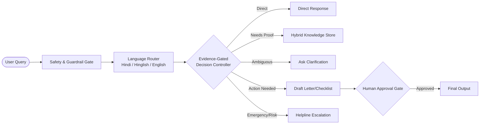

# SAATHI AI 🤝
> **Evidence-Gated, Safe, Multilingual AI Assistant for Daily Life Tasks**  
> *Research Prototype & Blueprint Implementation*

---

## 🌟 Overview
**SAATHI AI** is an AI assistant designed to help people (especially across Indian communities in English, Hindi, and Hinglish) understand everyday problems—such as **electricity bills, tenant rights, consumer grievances, and government schemes (PM-KISAN, LPG Subsidies)**—find verified solutions, and draft safe next actions with **strict human approval**.

---

## 🏗️ Architecture & Core Components



### Key Modules:
- **`saathi/controller/`**: Implements the Decision Policy (Direct Answer, Retrieve, Clarify, Prepare Action, Escalate).
- **`saathi/knowledge/`**: Hybrid RAG store with verified Indian utility, scheme, and legal guidelines.
- **`saathi/language/`**: Automatic detection for Hindi (Devanagari), Hinglish (Roman script Hindi), and English.
- **`saathi/safety/`**: Guardrails against prompt injection, sensitive credential leakage, and medical/legal emergencies.
- **`saathi/tools/`**: Generates formal consumer complaints, scheme checklists, and dispute letters.
- **`evaluation/`**: Repeatable automated benchmark suite comparing SAATHI against naive baselines.
- **`training/`**: QLoRA / LoRA fine-tuning pipeline for training your own model locally on GPU (RTX 4050 6GB) or Google Colab.

---

## 🚀 Quick Start (Running SAATHI)

### 1. Launch the Interactive Web App
```bash
./venv/bin/streamlit run app/main.py
```
Open [http://localhost:8501](http://localhost:8501) in your browser.

### 2. Run the Automated Evaluation Benchmark
```bash
./venv/bin/python3 evaluation/run_benchmark.py
```

---

## 🧠 Gemini 3.7-Style CoT Reasoning Architecture & Fine-Tuning

SAATHI AI features a local **Gemini 3.7-Style Hybrid Reasoning & Fine-Tuning Pipeline** running on the local **NVIDIA GeForce RTX 4050 Laptop GPU (6GB VRAM)**:

- **Base Architecture:** `Qwen/Qwen2.5-1.5B-Instruct` (1.54 Billion parameters)
- **Quantization:** 4-bit NormalFloat (NF4) with Double Quantization (`bitsandbytes`)
- **LoRA Configuration:** **Rank $r = 64$**, **$\alpha = 128$**, targeting all 7 attention and MLP layers (`q_proj`, `k_proj`, `v_proj`, `o_proj`, `gate_proj`, `up_proj`, `down_proj`) with **73.85 Million trainable parameters**.
- **Reasoning Format:** `<think>...</think>` Chain-of-Thought (CoT) policy verification, legal lookup, and safety checks before final output.
- **Sequence Length:** 768 tokens with Cosine Annealing Learning Rate scheduling.

```bash
# 1. Generate Gemini 3.7 CoT Dataset
./venv/bin/python training/prepare_training_data.py

# 2. Train QLoRA Adapter on GPU
./venv/bin/python training/train_qlora_local.py --epochs 12

# 3. Test Inferences with Thinking Traces
./venv/bin/python training/test_fine_tuned_model.py
```

