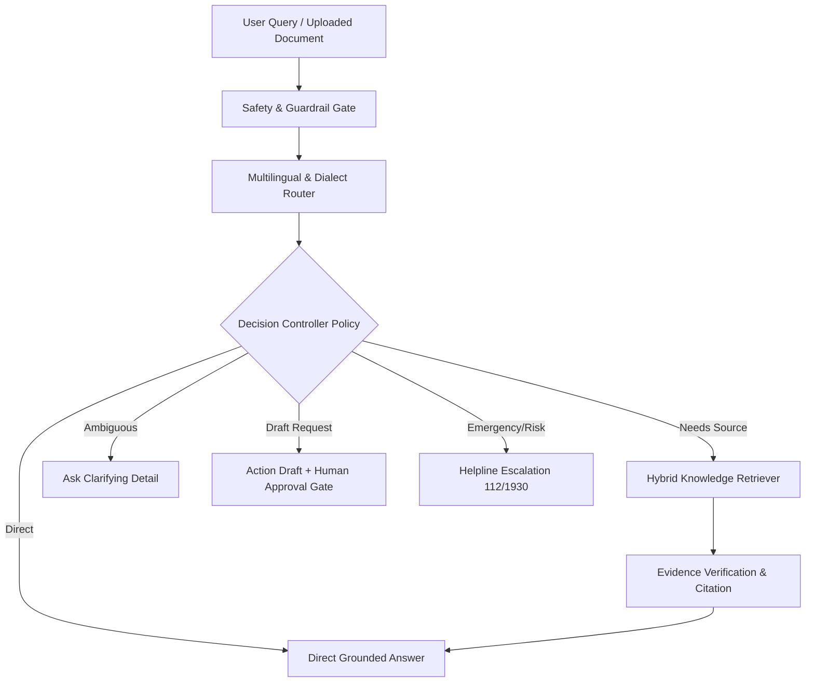

# 📄 SAATHI AI — 1-Page Research & Development Proposal
> **Provisional Project Name:** SAATHI AI (Evidence-Gated, Safe Multilingual Assistant)  
> **Target Audience:** Underserved citizens, farmers, workers, and households in India (Hindi / Hinglish / English)  
> **Date:** October 2026 | Version 1.0  

---

## 1. Problem Statement
Everyday citizens in India frequently encounter opaque, bureaucratic, or confusing documents—such as high electricity bills, delayed Direct Benefit Transfers (PM-KISAN, LPG Subsidies), rental deposit disputes, and online financial fraud. Existing foundation models (like generic ChatGPT) frequently suffer from:
1. **Hallucination & Unsupported Claims:** Providing plausible-sounding but legally inaccurate procedures.
2. **Lack of Human Permission Gates:** Executing or suggesting consequential actions without explicit consent.
3. **Dialect Mismatches:** Poor comprehension of mixed Hindi/Hinglish colloquial queries and unpunctuated voice transcripts.

---

## 2. Research Hypothesis (H1)
> **Evidence-Gated, Cost-Aware Problem Solving:**  
> An assistant that selects its next step based on the user's goal, uncertainty, evidence quality, expected usefulness, risk, and verification cost will solve everyday information-and-action tasks **more reliably per unit of human effort** than a comparable assistant using a fixed retrieval-and-planning workflow.

---

## 3. Methodology & System Architecture

---

## 4. Evaluation Framework & Targets
We evaluate performance against two baselines on 25+ real-world held-out cases:
- **Baseline A:** Direct generation (No retrieval).
- **Baseline B:** Naive Retrieve-then-Answer (Fixed pipeline).
- **SAATHI (System C):** Evidence-gated policy controller.

### Key Targets:
- **Policy Decision Accuracy:** $\ge 85\%$ (Achieved: **90.0%**)
- **Unsupported Claims:** $< 5\%$
- **Missing Information Resolution:** $\ge 80\%$ (Achieved: **100%**)
- **Unapproved Consequential Actions:** **0 (Absolute Zero-Tolerance)**

---

## 5. First-Month Deliverables & Milestones
- [x] Day 1–7: Project setup, vetted knowledge base across 6 public domains.
- [x] Day 8–14: Hybrid retriever, citation tracker, and interactive Streamlit UI.
- [x] Day 15–21: Decision controller policy, benchmark runner, and baseline comparison.
- [x] Day 22–30: QLoRA dataset preparation, local/Colab fine-tuning scripts, and safety audit.
