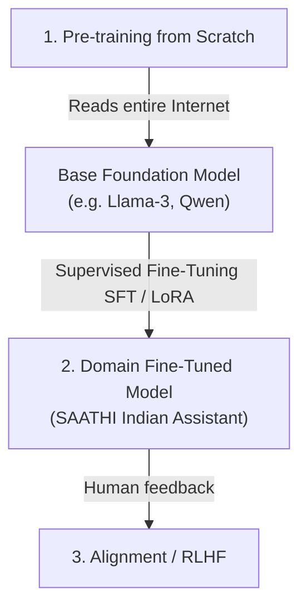

# 🎓 Student's Complete Guide to Training Your Own AI Model
> **Specially written for 1st-year college students starting their AI/ML journey.**

Welcome to the world of AI model training! As a 1st-semester student, learning how neural networks and Large Language Models (LLMs) work from first principles will give you a massive superpower.

---

## 1. What does "Training a Model" Actually Mean?

Think of a computer program like a student:
- **Traditional Coding (Python `if/else`):** You write exact step-by-step rules. If an unforeseen situation arrives, the code breaks.
- **Machine Learning / AI Training:** You don't write rules. Instead, you show the model thousands of examples of questions and good answers. The model **learns the underlying patterns** by itself!

An LLM is mathematically a giant mathematical function with **billions of numbers called "weights" or "parameters"** (like tiny knobs). Training is the process of turning those knobs until the model gives the right answers.

---

## 2. The 3 Types of AI Training: Which one do we do?



| Type | Analogy | Cost & Hardware | Used in SAATHI? |
| :--- | :--- | :--- | :--- |
| **1. Pre-training from Scratch** | Teaching a newborn human the entire English language and all Wikipedia facts from zero. | 1,000+ Industrial GPUs ($1,000,000+) | ❌ No (Too expensive for individuals) |
| **2. Fine-Tuning (LoRA / QLoRA)** | Taking a smart college graduate (an open-source base model) and giving them specialized training in Indian utility bills & Hindi/Hinglish schemes. | **Your Laptop GPU (RTX 4050 6GB) or Free Google Colab!** | ✅ **YES! This is what we will do.** |
| **3. Agentic RAG** | Giving the AI an open-book exam where it searches official documents in real-time before answering. | Runs on any standard PC | ✅ **YES! (Phase 1 engine)** |

---

## 3. How Fine-Tuning (LoRA / QLoRA) Works (Simple Explanation)

In the past, fine-tuning an 8-Billion parameter model required 32 GB of VRAM. But in 2021, researchers invented **LoRA (Low-Rank Adaptation)** and **QLoRA (4-bit Quantization)**:

1. **Freeze the original model:** We freeze 99% of the base model's brain so it doesn't forget general grammar and logic.
2. **Add tiny adapter layers:** We attach small "adapter matrices" (only 1% to 2% of total weights).
3. **4-Bit Quantization:** We compress the model numbers from 16-bit to 4-bit, shrinking the memory footprint from 16GB down to just **3–4 GB of VRAM**!
4. **Train only the adapters:** Your **RTX 4050 GPU (6 GB VRAM)** trains these adapters easily in 15–30 minutes!

---

## 4. The 4 Steps to Train Your SAATHI Model

```
Step 1: Dataset Creation ──► Step 2: Tokenization ──► Step 3: Gradient Descent ──► Step 4: Adapter Merge
(JSONL Prompts & Answers)   (Words to Numbers)       (Adjusting LoRA Knobs)         (Ready for App)
```

### Step 1: Prepare the Training Data (`train.jsonl`)
The model learns from `(Instruction, Input, Output)` pairs formatted in JSONL:
```json
{
  "instruction": "Explain how to file a complaint for high electricity bill.",
  "input": "Mera bijli ka bill bahut jyada aaya hai meter kharab lagta hai",
  "output": "1) Meter reading ko bill se milayein. 2) SDO office me complaint file karein. 3) Agar 30 din me solve na ho toh CGRF me escalate karein."
}
```

### Step 2: Run the Training Script
Run our ready-made script in your terminal:
```bash
python3 training/train_qlora_local.py
```
During training, you will see the **Loss** (error rate) dropping from e.g. `2.85` down to `0.35`!

### Step 3: Test your Fine-Tuned Model
Run:
```bash
python3 training/test_fine_tuned_model.py
```
You will see your newly trained model answering Hindi/Hinglish questions with the exact SAATHI decision logic!

---

## 5. College Project Viva / Presentation Tips
When your college professors or judges ask you:
- **"Did you build this from scratch?"**
  *Answer:* *"We used an open-weight foundation model (like Qwen 2.5 / Llama 3.2), implemented an Evidence-Gated Agent Controller with hybrid RAG, and fine-tuned domain-specific LoRA adapters on Indian governance & document understanding datasets."*
- **"Why not just use ChatGPT API?"**
  *Answer:* *"ChatGPT can hallucinate and doesn't follow strict human approval gates. SAATHI AI integrates local fine-tuned policy weights, multi-language Hinglish routing, and zero-trust permission checks for vulnerable users."*
